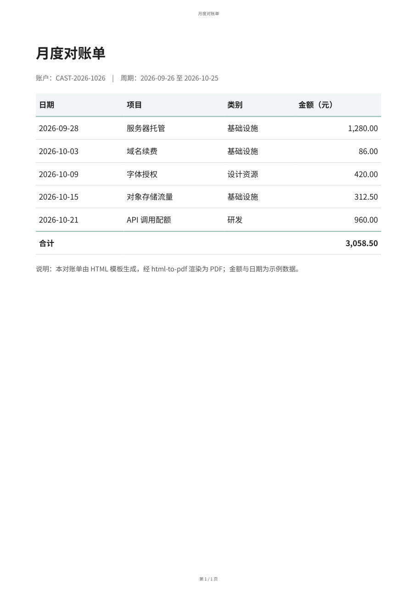

# html-to-pdf

把 HTML 文件、整个目录或在线网页渲染成版面可控的 PDF。

基于本机已装的 **Microsoft Edge**（无 Edge 时回落 Chrome）无头模式，通过 **DevTools 协议（CDP）** 打印——**零 npm 依赖、默认不联网、不改源文件**。

| 项目 | 说明 |
|---|---|
| 版本 | 0.1.0 |
| 运行环境 | Node ≥ 22（用到内置 `WebSocket` / `fetch`），Edge 或 Chrome |
| 形态 | 命令行工具；同时可直接放入 `~/.agents/skills/` 作为 Harness 技能 |
| 许可 | MIT |



---

## 1. 解决什么问题

把网页变成 PDF，常见的几条路各有各的别扭：

- **浏览器「打印 → 另存为 PDF」**：要人手点，纸张、边距、页码散落在对话框里，无法批量、无法进脚本。
- **wkhtmltopdf 之类旧引擎**：年久失修，现代 CSS（flex/grid、渐变、`break-inside`）支持有限，中文与字体常出问题。
- **Puppeteer / Playwright**：要额外下载数百 MB 的 Chromium，离线或受限环境难落地，只是转个 PDF 显得过重。

本项目复用**本机已有的浏览器**：起一个无头实例，用 CDP 打开页面，再调用 `Page.printToPDF` 出纸。相比浏览器命令行的 `--print-to-pdf`，CDP 才拿得到这些控制项：

- 背景色与背景图（`printBackground`）
- 逐边页边距（`marginTop/Right/Bottom/Left`）
- 页眉页脚模板与 `{page}` / `{total}` 页码（`displayHeaderFooter`）
- 是否让 CSS `@page` 优先（`preferCSSPageSize`）
- 内容缩放（`scale`）

于是「纸张、方向、边距、页码、背景、批量」可以一条命令给全，产物落到指定位置，**源 HTML 不被修改**。

**不负责**：OCR、PDF 编辑/合并/加密、Office 文档转换（那是 `office-export-pdf` 的事）。

## 2. 主要功能

| 能力 | 说明 | 相关参数 |
|---|---|---|
| 三种输入 | 单个 `.html` 文件 / 目录批量（不递归）/ `http(s)` 在线页面 | `--input` |
| 纸张与方向 | A3、A4、A5、A6、B5、Letter、Legal、Tabloid、Ledger，或自定义 `210x297mm`、`8.5x11in` | `--format` `--landscape` |
| 页边距 | 统一边距，或四边分别指定（`mm`/`cm`/`in`/`pt`/`px`） | `--margin` `--margin-*` |
| 页眉页脚 | 纯文本 + `{page}` `{total}` `{title}` `{url}` `{date}` 占位符 | `--header` `--footer` |
| 打印背景 | 默认打印背景色、背景图与边框 | `--no-background` 关闭 |
| 尺寸优先级 | 默认跟随文档 `@page`；给了 `--format` 则由脚本注入同值 `@page` 强制生效 | `--prefer-css-page-size` |
| 内容缩放 | 0.1–2 倍，用于宽表或“一页装下” | `--scale` |
| 注入 CSS | 不改源文件就改版面（分页、隐藏元素、配色） | `--css` `--css-file` |
| 等 JS 渲染 | 等目标元素出现、额外延时、导航超时 | `--selector` `--wait` `--timeout` |
| PDF 元数据 | 覆写文档标题，写进 PDF 的 Title 字段 | `--title` |
| 自检 | `%PDF-` 签名、最小体积、按结构统计页数 | 自动 |
| 批量容错 | 单个文件失败不中断，末尾汇总，有失败则退出码 1 | 自动 |
| 现场保留 | 保留临时浏览器 profile 以便排查 | `--keep-open` |
| 脚本友好 | 只输出产物路径 | `--quiet` |

## 3. 安装方法

### 前置条件

| 依赖 | 要求 | 检查 |
|---|---|---|
| Node.js | ≥ 22（需要全局 `WebSocket`） | `node --version` |
| 浏览器 | Microsoft Edge 或 Google Chrome | 无需手动指定，脚本按常见路径自动探测 |

Windows 上默认查找顺序：`Program Files (x86)\Microsoft\Edge\...` → `Program Files\Microsoft\Edge\...` → Chrome（x64 / x86）。Linux/macOS 探测 `microsoft-edge`、`google-chrome` 与 macOS 的 Chrome 路径。

**不需要 `npm install`**：脚本只用 Node 标准库。

### 方式一：作为 Harness 技能

把整个 `html-to-pdf` 目录放进技能目录：

```powershell
# 首次放置（skills 目录已存在时，这样不会套出 html-to-pdf\html-to-pdf）
Copy-Item -Recurse .\html-to-pdf "$env:USERPROFILE\.agents\skills\"

# 已装过、只想覆盖更新（/E 补新文件，不删除目标里的其他内容）
robocopy .\html-to-pdf "$env:USERPROFILE\.agents\skills\html-to-pdf" /E
```

Harness 会自动加载，技能目录里出现 `html-to-pdf` 后即可用自然语言触发。

### 方式二：作为独立命令行工具

放任意位置直接跑，不依赖 Harness：

```powershell
node .\html-to-pdf\scripts\html2pdf.mjs --help
```

### 验证安装

```powershell
node scripts\html2pdf.mjs --help
node scripts\html2pdf.mjs -i examples\sample.html -o examples\sample.pdf
```

实测输出（Windows + Edge + Node 24）：

```text
PDF  : ...\examples\sample.pdf
源   : ...\examples\sample.html
页面 : 1 页 · 36.3 KB · CSS @page
耗时 : 4.1s
```

看到 `%PDF-` 产物与「N 页 · X KB」即安装成功。

### 示例字体（可选）

`examples/` 里的 PDF 用 **Noto Sans SC**（OFL 许可）渲染：先试家族 `Noto Sans SC Static`，没有则回落 `Noto Sans SC`、`Source Han Sans SC`、系统无衬线。

之所以要有 `Static` 这一层：Noto Sans SC 目前多以**可变字体**（VF）形式安装，而 Chromium 无法把 VF 嵌成 CID 字体，会退化成一堆 Type3 字形对象（体积翻倍、部分打印店不认）。仓库因此附带一个小工具，从 VF 生成 400/700 两个静态实例：

```powershell
# 只生成到临时目录
python scripts\make-static-font.py --source "C:\Windows\Fonts\NotoSansSC-VF.ttf" --outdir .\fonts

# 生成并装进当前用户字体目录（无需管理员；可 --uninstall 撤回）
python scripts\make-static-font.py --source "C:\Windows\Fonts\NotoSansSC-VF.ttf" --install
python scripts\make-static-font.py --uninstall
```

这只是为了复现示例的原样字体；工具本身对字体没有任何要求。

装好后若发现某个字体文件被浏览器占用（Windows 会把已加载的字体文件锁住），脚本会自动换用带序号的文件名并登记新路径，效果不变；旧的锁定文件在注销后可手动删除。

## 4. 使用方法

### 基本语法

```text
node scripts/html2pdf.mjs --input <文件|目录|URL> [--output <文件|目录>] [选项...]
```

### 常用命令

```powershell
# 1) 最简：输出到源文件旁（sample.html -> sample.pdf）
node scripts\html2pdf.mjs -i .\report.html

# 2) 指定纸张、页眉页脚与 PDF 标题
node scripts\html2pdf.mjs -i .\report.html -o .\out\report.pdf `
      -f A4 --header "{title}" --footer "第 {page} / {total} 页" --title "季度报告"

# 3) 整目录批量（不递归），失败不中断
node scripts\html2pdf.mjs -i .\pages -o .\pdf --quiet

# 4) 在线网页留档
node scripts\html2pdf.mjs -i https://example.com -o site.pdf

# 5) 宽表：A5 横向 + 缩放
node scripts\html2pdf.mjs -i .\wide-table.html -o .\wide.pdf -f A5 -l --scale 0.9

# 6) 等前端渲染完成再打印
node scripts\html2pdf.mjs -i .\dashboard.html -o .\dashboard.pdf --selector "#chart svg" --wait 800
```

### 输出路径规则

| 输入 | 未给 `--output` | 给了 `--output` |
|---|---|---|
| 单个文件 | 源文件同目录，同名 `.pdf` | 视作文件路径；不以 `.pdf` 结尾会自动补上 |
| 目录 | 每个 `.pdf` 落在源目录 | 视作输出目录（不存在则创建） |
| URL | 当前目录 `page.pdf` | 视作文件路径；不以 `.pdf` 结尾会自动补上 |

输出目录会被自动创建；同名文件直接覆盖。

### 页眉页脚占位符

| 占位符 | 含义 |
|---|---|
| `{page}` | 当前页码 |
| `{total}` | 总页数 |
| `{title}` | 文档标题（可用 `--header-title` 覆盖） |
| `{url}` | 页面 URL（本地文件为 `file://` 地址） |
| `{date}` | 打印日期 |

页眉页脚为纯文本加上述占位符，文本部分会做 HTML 转义，**不支持塞入任意 HTML 或图片**。上下边距小于 15mm、又没显式指定该边距时，脚本会把该边距抬到 15mm，避免压住正文（想更紧就写 `--margin-top 12mm`）。

页眉页脚的字体固定为开源族（`Noto Sans SC` → `Source Han Sans SC` → 系统无衬线），**不继承正文样式**——Chromium 的页眉页脚是独立文档，内联 `font-family` 不会传下去，脚本用模板内的 `<style>` 强制指定。这样即使正文用了商业字体，页眉页脚也不会把它写进 PDF。

### 纸张与边距的优先级

1. **不给 `--format`/`--landscape`**：完全跟随文档的 `@page`（尺寸与边距）；文档未声明时按 A4、10mm。
2. **给了 `--format` 或 `--landscape`**：脚本注入一条等值的 `@page` 规则，覆盖文档里的尺寸与边距——纸张、方向、边距都以命令行为准。
3. **想反过来**（即使传了 `--format` 也让文档 `@page` 压过参数）：加 `--prefer-css-page-size`。

> 缘由：Chromium 只要在文档里读到 `@page { size: ... }`，就会按它决定纸张与方向，光设 `paperWidth/paperHeight` 压不住；因此传参时必须显式改写 `@page`。

### 退出码

| 码 | 含义 |
|---|---|
| `0` | 全部成功 |
| `1` | 至少一个文件转换失败（批量时会继续处理其余文件） |
| `2` | 参数错误（未知选项、无法解析的纸张/边距、缺少 `--input`） |

### 批量行为

- 只扫描目录**第一层**的 `.html` / `.htm` / `.xhtml`，按文件名排序。
- 每个文件独立成败：失败只在汇总里记一行，不打断其余任务。
- 结束时输出 `合计 : N 成功 / M 失败`；有失败则进程退出码为 1，便于 CI 判定。

## 5. 输入输出示例

### 示例一：单文件（跟随文档 `@page`）

输入 `examples/sample.html`（节选，完整见文件）：

```html
<!DOCTYPE html>
<html lang="zh-CN">
<head>
<meta charset="utf-8">
<title>月度对账单</title>
<style>
  @page { size: A4; margin: 18mm 16mm; }
  body { font-family: "Noto Sans SC", sans-serif; font-size: 11pt; }
  table { width: 100%; border-collapse: collapse; }
  th { background: #f2f6f5; border-bottom: 2px solid #9bc4b8; }
  td.num { text-align: right; }
</style>
</head>
<body>
  <h1>月度对账单</h1>
  <table>
    <thead><tr><th>日期</th><th>项目</th><th>类别</th><th class="num">金额（元）</th></tr></thead>
    <tbody><tr><td>2026-09-28</td><td>服务器托管</td><td>基础设施</td><td class="num">1,280.00</td></tr></tbody>
    <tfoot><tr><td colspan="3">合计</td><td class="num">3,058.50</td></tr></tfoot>
  </table>
</body>
</html>
```

命令：

```powershell
node scripts\html2pdf.mjs -i examples\sample.html -o examples\sample.pdf
```

输出（实测）：

```text
PDF  : ...\examples\sample.pdf
源   : ...\examples\sample.html
页面 : 1 页 · 36.3 KB · CSS @page
耗时 : 4.5s
```

产物事实：`1` 页，页面 `595.0 × 841.9 pt`（A4），PDF Title 元数据为「月度对账单」，内嵌字体只有 `NotoSansSCStatic-Regular/Bold` 两个子集（Noto Sans SC，OFL 许可），无商业字体。

### 示例二：页眉页脚 + 元数据标题

```powershell
node scripts\html2pdf.mjs -i examples\sample.html -o examples\sample-footer.pdf `
      --header "{title}" --footer "第 {page} / {total} 页" --title "月度对账单"
```

```text
页面 : 1 页 · 37.1 KB · CSS @page
```

页面上缘出现「月度对账单」，下缘出现「第 1 / 1 页」，PDF Title 同为「月度对账单」。

### 示例三：A5 横向（参数压过文档 `@page`）

```powershell
node scripts\html2pdf.mjs -i examples\sample.html -o examples\sample-a5l.pdf -f A5 -l -m 10mm
```

```text
页面 : 1 页 · 36.3 KB · 210x148mm 横向
```

产物事实：`595.9 × 420.0 pt` —— 真正横向的 A5，内容按宽幅重排，而非把 A4 内容缩到横向纸里。

### 示例四：批量与脚本化

```powershell
node scripts\html2pdf.mjs -i .\pages -o .\pdf --quiet
```

```text
<输出目录>\a.pdf
<输出目录>\b.pdf
```

`--quiet` 只把产物路径写到标准输出（失败信息走标准错误），便于管道接手：

```powershell
$pdfs = node scripts\html2pdf.mjs -i .\pages -o .\pdf --quiet
if ($LASTEXITCODE -ne 0) { Write-Error "有文件转换失败" }
```

### 示例五：在线网页

```powershell
node scripts\html2pdf.mjs -i https://example.com -o site.pdf -f A4
```

```text
页面 : 1 页 · 55.9 KB · 210x297mm
```

渲染的是实时页面（含 JS 执行后的 DOM）；需要等前端异步渲染时，配合 `--selector` / `--wait`。

## 6. 已知限制

- **不生成书签/大纲**：Chromium 的 `printToPDF` 不提供 outline 输出。
- **不能只导指定页码**：一次总是整篇。
- **无加密、数字签名、PDF/A、表单域**。
- **图片压缩质量不可调**：体积基本由源图决定，要更小只能先处理源图。
- **页眉页脚不能是任意 HTML**：仅纯文本 + 占位符；字体固定为开源族，不随正文变化。
- **可变字体（VF）会被拆成 Type3**：Chromium 无法把 VF 嵌成 CID 字体，字形退化为逐字 Type3、体积翻倍。需要干净产物时，改用同族静态字重实例（见 [troubleshooting](references/troubleshooting.md) 第 2 节）。
- **不执行交互**：需要登录、点击、滚动才出现的页面，请先保存为本地 HTML，或用 `--selector` 等目标节点出现。
- **打印媒体样式**：脚本以 `print` 媒体渲染，与屏幕显示可能有出入（这是分页文档的常态）。
- **页数统计方式**：自检时扫描 PDF 的 `/Type /Page` 对象，Chromium 输出下与实际一致；第三方工具重写过的 PDF 不在此工具职责内。

## 7. 故障排查

现象 → 处置的对照表见 [references/troubleshooting.md](references/troubleshooting.md)，覆盖：空白页、中文字体、图片缺失、表格被切断、页眉遮挡、超时、尺寸不符、浏览器起不来、体积过大。

需要保留现场时加 `--keep-open`，脚本会打印临时 profile 路径。

## 8. 目录结构

```text
html-to-pdf/
├── README.md                  # 本文件：给人看的项目说明
├── SKILL.md                   # 给 Agent 看的技能指令与速查表
├── LICENSE                    # MIT 许可证全文
├── scripts/
│   ├── html2pdf.mjs           # 唯一入口：零依赖 Node 脚本
│   └── make-static-font.py    # 可选：从可变字体生成静态实例（供示例复现）
├── references/
│   └── troubleshooting.md     # 十类故障的现象与处置
└── examples/
    ├── sample.html            # 示例输入（对账单模板）
    ├── sample.pdf             # 默认输出（跟随 @page）
    ├── sample-footer.pdf      # 带页眉页脚与元数据标题
    ├── sample-a5l.pdf         # A5 横向
    └── preview.png            # 渲染预览图
```

## 9. 实现要点（给维护者）

- 启动浏览器：`--headless=new --remote-debugging-port=0 --user-data-dir=<临时目录>`，从 `DevToolsActivePort` 读实际端口，再 `/json/list` 取 page target。
- 子进程用 `stdio: 'ignore'`，避免在受限环境里因管道受限导致失败。
- 加载等待链：`Page.loadEventFired` → `document.fonts.ready` → 未完成的 `` → 双 `requestAnimationFrame`。
- 打印前 `Emulation.setEmulatedMedia({ media: 'print' })`，确保打印样式生效。
- 校验：`%PDF-` 签名、体积下限、页数统计；临时 profile 结束时清理（`--keep-open` 可保留）。
- 退出码约定：0 成功 / 1 转换失败 / 2 参数错误。

## 许可

本项目以 [MIT 许可证](LICENSE) 发布，`Copyright (c) 2026 Castorice`。

简言之：可自由使用、修改、再分发、商用，保留版权与许可声明即可；软件按「现状」提供，不附任何担保。
